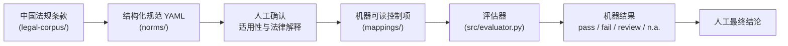

# 中国 AIGC 法条到控制项转换框架

[English](README.md) | **中文**

> 将选定的中国 AIGC 法规条款，转化为可追溯、经人工复核、机器可读的合规控制项。


[](https://github.com/yuxuancheng123-spec/china-aigc-compliance-evidence/actions/workflows/ci.yml)

**论文：** [JURIX 2026 短论文](paper/jurix2026/main.tex) · [完整稿](paper/main.tex) &nbsp;|&nbsp; **Demo：** [AI 演员合规 Demo](https://yuxuancheng123-spec.github.io/ai-generated-actor-compliance/web/) &nbsp;|&nbsp; **作品集：** [yuxuan-cheng-portfolio-next.vercel.app](https://yuxuan-cheng-portfolio-next.vercel.app)



| 产出物 | 数量 |
|---|---|
| 法规来源文件（[source-index.csv](legal-corpus/source-index.csv)） | 5 |
| 结构化法律规范（[norms/](norms/)） | 11 |
| 机器可读控制项（[clause-to-control.yml](mappings/clause-to-control.yml)） | 12 |
| 按最终自动化程度划分的控制项 | 完全自动 2 · 部分自动 1 · 需人工复核 9 |
| 验证用例（[validation-cases.yml](examples/validation-cases.yml)） | 21 |
| 测试模块 / 测试函数（[tests/](tests/)） | 8 / 46 |

本项目是一个研究框架，用于把选定的中国 AIGC 法律条款转化为可追溯、可复核、机器可读的合规控制项。

本仓库研究如何将中国 AIGC 相关法律、法规和技术标准中的自然语言条款，拆解为结构化法律规范，再转化为机器可读的控制项。它**并不**打算做成面向用户的合规评估产品。配套项目 [`ai-generated-actor-compliance`](https://github.com/yuxuancheng123-spec/ai-generated-actor-compliance) 展示的是如何把已定义好的规则应用到具体的 AI 演员、数字人和合成媒体场景中；本仓库关注的是上游的研究问题：**规则从哪里来，其法律解释如何追溯回原始条款？**

当前论文稿：[paper/main.tex](paper/main.tex)。正式参考文献维护在 [paper/references.bib](paper/references.bib)；计划中的独立复核材料位于 [paper/review/](paper/review/)。

早期的补充性原型论文已被当前的"法条到控制项"论文稿取代：[Making China AIGC Compliance Evidence Machine-Readable: A Governance Pipeline Prototype for Synthetic Actor and Digital Human Platforms](article/china-aigc-compliance-evidence-paper.pdf)。`article/latex.zip` 中归档的 LaTeX 包同样作为已被取代的原型产物保留。

所有示例均为合成或转述内容，仅供研究使用。本项目不使用任何真实的个人数据、人脸数据、声音数据、生物识别数据、合同、公司记录、客户记录或生产环境媒体。

## 研究重点

核心转换链如下：

```text
正式的中国法律条款
-> 完整的法律规范产物
-> 经人工确认的解释与适用性
-> 机器可读控制项
-> 评估器执行
-> 机器结果与人工最终结论
```

机器可读层本身不解释法律。它执行的是由人撰写并复核过的结构化法律解释。

## 研究问题

- **RQ1：** 中国 AIGC 法律法规条款可以拆解为哪些语义要素，以便进行机器可读表示？
- **RQ2：** 如何在原始条款、法律解释、控制目标、证据要求和可执行测试之间建立可追溯的映射？
- **RQ3：** 哪些类别的法律义务可以完全自动化、部分自动化，或必须依赖人工法律审查？
- **RQ4：** 所提出的转换方法能否为合成演员与数字人场景生成一致且可执行的控制项？

## 本仓库的产出

- 一个由选定中国 AIGC 相关条款组成的小型法律语料库。
- 条款拆解标注，包含主体、模态、行为、对象、触发条件、例外、时限、证据、自动化程度、模糊程度和复核状态等语义字段。
- 法律规范与可追溯控制项的 JSON Schema。
- 为每个已映射的 `norm_id` 提供一份完整的 YAML 法律规范产物。
- 带来源追溯的条款到控制项映射。
- 关于同意、显式标识和模型备案的示例控制项。
- 一个精简的评估器，可执行经复核的机器可读测试，并返回 `pass`、`fail`、`review` 或 `not_applicable`。
- 一个小型验证集，用于检查控制项是否可追溯、可执行，并在需要时正确转入人工复核。

此前的合成请求流水线仍作为补充性概念验证保留。它表明结构化控制项可以被软件读取，并在合成运营记录上运行，但它已不再是主要的研究贡献。

## 复核状态

"已复核"（`Reviewed`）目前指由研究者本人内部复核，除非另有记录表明已由合格法律专家复核。映射文件区分 `author_review_status` 与 `legal_expert_review_status`。

法律来源的修正和收窄后的自动化边界记录在 [CHANGELOG.md](CHANGELOG.md) 中。

## 仓库结构

```text
china-aigc-compliance-evidence/
├── legal-corpus/          # 来源索引与选定条款摘要
├── annotations/           # 法律语义拆解与解释说明
├── norms/                 # 规范化的完整法律规范 YAML
├── schema/                # 法律规范与控制项的 JSON Schema
├── mappings/              # 条款到控制项映射与追溯矩阵
├── examples/              # 精简规则示例与验证用例
├── src/
│   ├── validator.py       # 规范/控制项的 Schema 与可追溯性校验
│   ├── evaluator.py       # 小型已复核规则评估器
│   └── ...                # 补充性合成概念验证流水线
├── tests/                 # 回归测试与转换方法测试
├── paper/                 # 重新聚焦后的论文稿
│   ├── figures/            # TikZ 研究方法图源文件
│   └── review/             # 计划中的独立复核方案与模板
├── article/               # 早期论文配套产物
├── outputs/               # 补充性概念验证生成结果
├── README.md
└── references.md
```

## 最小示例

```text
正式的中国法律条款
-> 结构化规范：CN-AIGC-LABEL-001
-> 经人工确认的适用性
-> 显式标识存在性控制项
-> 第九条"向提供方交付"例外路径
-> 显著性复核控制项
-> 机器结果
-> 最终复核状态

applicability:
  output_is_ai_generated: true
  output_is_user_facing: true
  output_matches_explicit_label_scenario: true

human_confirmations:
  output_matches_explicit_label_scenario:
    confirmed: true
    value: true
    reviewer_role: compliance_reviewer
    reviewed_at: "2026-07-15"

machine_result: pass
final_status: review
review_reason: label prominence still requires human review
```

在场景经人工确认后，标识存在性控制项即可给出机器结果。独立的显著性控制项则保持 `review`，直到对应键的人工复核记录完成。第九条仅记录"向提供方交付"例外的证据是否完整，并不决定后续的公开发布或传播义务。

## 自动化层级

本仓库区分三层自动化：

1. 适用性判定；
2. 证据测试执行；
3. 最终合规结论。

即使法律适用性或最终结论需要人工确认，机器可读的证据测试本身也可能是完全可自动化的。因此每个控制项都带有 `automation_profile`，包含 `applicability`、`evidence_test` 和 `final_decision`；`automation_level` 则作为控制项最终状态的兼容性摘要保留。

每条映射规则声明以下三种自动化程度之一：

- `fully_automatable`：结构化证据可被机械检查，例如元数据字段是否存在。
- `partially_automatable`：软件可以检查部分证据，但在声明的人工复核键完成前，最终状态保持 `review`。
- `human_review_required`：义务依赖开放性的法律判断，例如"有效措施"是否充分。

评估器支持四种结果：

- `pass`：机器证据满足完全可自动化的控制项，或必需的人工复核记录了通过结论。
- `fail`：经复核的证据与机器可读测试相矛盾。
- `review`：证据缺失、存在歧义，或需要法律判断。
- `not_applicable`：条款的触发条件未满足。

## 运行时证据校验

[evaluation-evidence-schema.json](schema/evaluation-evidence-schema.json) 会在验证用例进入评估器之前，校验运行时的 `human_confirmations` 和带键的 `human_reviews`。Schema 校验记录结构；评估器另行检查语义事实，例如确认值是否与业务证据一致、声明的复核键是否完成。

每条规范还保存 `source_excerpt_sha256`，即 `source_text_zh.strip().encode("utf-8")` 的 SHA-256 摘要，用于检测仓库内摘录是否被改动。其 `metadata_only` 快照状态并不表示该摘录已与当前官方网页逐字独立核对。

## 论文配套与复核设计

论文配套材料区分已完成的仓库内验证与计划中的独立验证。`paper/main.tex` 引用 `paper/references.bib` 中的一手法律、标准和研究文献；`paper/figures/transformation-pipeline.tex` 绘制"法条到控制项"方法图；`paper/review/` 提供第二编码员、合格法律复核人和透明裁决所用的空白模板。

本项目不声称已获得独立第二编码员一致性结果或合格法律专家结论。拟议方案将依据正式中文来源复核全部 11 条规范，并保留分歧而非覆盖分歧。

## 快速开始

```bash
python3 -m venv .venv
source .venv/bin/activate
pip install -r requirements.txt
python -m src.validator
python -m src.evaluator
python -m pytest
```

一条命令运行端到端演示（条款 -> 规范 -> 控制项 -> 评估）：

```bash
make demo            # 或：python -m src.demo / ./scripts/demo.sh
```

每次 push 和 pull request 都会由 CI（Python 3.11）运行测试、校验器和演示。

补充性概念验证流水线：

```bash
python -m src.cli --seed 20260625
```

该命令会在 `outputs/` 下重新生成合成的请求级产物。这些产物可用于演示控制项能够被执行，但并非核心研究贡献。

## 选定条款范围

所选语料有意保持有限，涵盖以下方面的代表性条款：

- 同意以及敏感个人信息的单独同意；
- 演员、声音、人脸或类生物识别素材的分类；
- AIGC 显式标识；
- 机器可读或元数据标识；
- 模型备案或适用性审查；
- 内容安全措施；
- 投诉与举报机制。

本项目不试图完整覆盖中国 AI 法律、行业特定义务或生产环境合规流程。

## 与 AI 演员合规 Demo 的关系

本仓库产出机器可读规则与可追溯性产物，并非面向用户的合规评估产品。

独立的 `ai-generated-actor-compliance` 项目是产品形态的 Demo：它接收业务事实、运行规则，并针对具体场景生成风险报告和整改建议。相比之下，本仓库研究的是一条规则如何从法律条款转化为经复核、可追溯、可执行的控制项。

## 局限性

- 条款摘要是研究标注，并非官方译文。
- 映射仅作示意，投入实际使用前需经合格法律复核。
- 来源校验确认的是字段完整性和仓库内一致性，并不能自动证明所存文本与当前官方网页完全一致。
- 第九条的处理仅限于"向提供方交付"，本项目不自动判定下游公开传播义务。
- 评估器只执行经人工复核的结构化解释。
- 若干义务被有意归类为 `partially_automatable` 或 `human_review_required`。
- 合成概念验证数据不能证明真实世界中的法律合规。
- 不使用任何真实的个人、生物识别、人脸、声音、合同、公司、客户或生产环境媒体数据。

## 法律声明

本项目仅用于研究、技术演示和作品集展示，不构成法律意见，不认证合规，也不表明任何真实系统满足任何法律、法规、标准、备案义务或监管期望。
